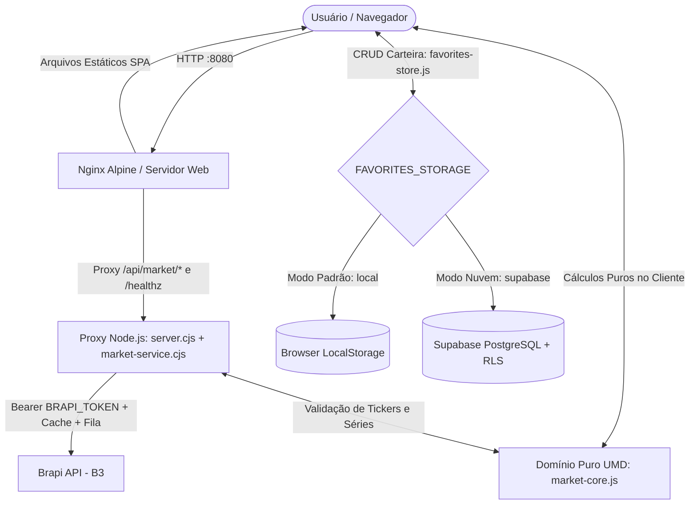

# FIIsFinder — Etapa 03 (Bootcamp II)

Plataforma web FinTech para consulta de cotações da B3, análise gráfica histórica, gestão de carteira de ativos favoritos e simulação patrimonial (**Estimativa de Proventos, Calculadora de Juros Compostos e Simulador de Reinvestimento de Dividendos**).

O projeto consolida três etapas evolutivas de engenharia de software:
- **Etapa 01:** Single Page Application (SPA) responsiva em HTML5, CSS3 (Design Tokens Dark Theme) e Vanilla JavaScript (ES6+), integrada à API da Brapi.
- **Etapa 02:** Persistência em nuvem com **Supabase (PostgreSQL + Row Level Security)**, operações completas de **CRUD**, conteinerização com **Docker e Nginx Alpine** e entrega integral das **Sidequests Oficiais (SQ1 a SQ4)**.
- **Etapa 03:** Engenharia colaborativa com governança Git, proteção da branch `main`, pipeline de **CI/CD no GitHub Actions**, proxy backend em **Node.js** com cache e serialização de concorrência, gráficos históricos com **Chart.js**, módulo de **Planejamento Financeiro & Simulações** e suíte de testes automatizados nativos com `node:test`.

---

## 1. Integrantes e Divisão de Escopo (Etapa 03)

| Integrante | RA / Matrícula | Usuário GitHub | Papel e Contribuição Técnica na Etapa 03 | Pull Request Aprovada |
| :--- | :--- | :--- | :--- | :--- |
| **Henrique Lopes Borges De Souza** | 22612443 | `owmygod12` | • **Autor original da arquitetura base**, conteinerização Docker/Nginx, pipeline de CI e SPA.<br>• Implementação da **Calculadora de Juros Compostos** e do **Simulador de Reinvestimento de Dividendos** (`market-core.js`).<br>• Camada de validação defensiva contra entradas numéricas inválidas.<br>• Suíte de testes unitários automatizados para regras financeiras (`tests/calculators.test.cjs`). | [PR #X - Calculadoras & Testes](https://github.com/owmygod12/FiisFinder-entrega-final/pulls) |
| **Victor Augusto Rosendo Galvão** | 22611054 | `turi-pixel` | • Expansão do catálogo de busca (remoção do limite de caracteres, busca por razão social e suporte ampliado a Ações e BDRs).<br>• Integração da biblioteca visual (Chart.js) para renderização do histórico de cotações.<br>• Ajustes na persistência da carteira no Supabase.<br>• Suíte de testes de integração e proxy da API (`tests/*.test.cjs`). | [PR #1 - Busca, Gráficos & Proxy](https://github.com/owmygod12/FiisFinder-entrega-final/pull/1) |

---

## 2. Identidade e Links de Infraestrutura

- **Repositório Oficial da Entrega Final (Etapa 03):** [https://github.com/owmygod12/FiisFinder-entrega-final](https://github.com/owmygod12/FiisFinder-entrega-final)
- **Repositório Base Original (Etapas 01 e 02):** [https://github.com/owmygod12/FIIsFinder](https://github.com/owmygod12/FIIsFinder)
- **Deploy Estático Inicial (GitHub Pages - Etapa 01):** [https://owmygod12.github.io/FIIsFinder/](https://owmygod12.github.io/FIIsFinder/)
- **Repositório Oficial no Docker Hub:** [https://hub.docker.com/r/henriquelopescaze/fiisfinder](https://hub.docker.com/r/henriquelopescaze/fiisfinder)
- **Imagem e Tags Publicadas no Registry:** `henriquelopescaze/fiisfinder` (`1.0`, `1.1` e `latest`)
- **Banco de Dados Gerenciado (Supabase):** [https://supabase.com/](https://supabase.com/)
- **Provedor de Dados Financeiros B3 (Brapi):** [https://brapi.dev/](https://brapi.dev/)

---

## 3. Governança, Proteção de Branch e CI/CD

O fluxo de trabalho colaborativo da Etapa 03 adota **Feature Branch Workflow** com regras estritas de governança configuradas diretamente no GitHub sobre a branch principal (`main`):

1. **Bloqueio de Push Direto na `main`:** Todas as entregas partem de branches dedicadas (como `feature/melhoria-filtros` e `feature/calculadoras-financeiras`) e só ingressam na `main` via Pull Request.
2. **Revisão por Pares Obrigatória (*Code Review*):** Regra `Require a pull request before merging` com aprovação obrigatória de outro integrante antes da liberação do botão de merge.
3. **Validação Compulsória de Status Checks (CI/CD):** Regra `Require status checks to pass before merging` vinculada ao workflow [`.github/workflows/tests.yml`](./.github/workflows/tests.yml). A cada abertura ou atualização de Pull Request direcionada à `main`, o GitHub Actions provisiona um runner `ubuntu-latest` com **Node.js 22** e executa:
   - `npm test` (`node --test`): Execução completa de todas as suítes unitárias e de integração.
   - `npm run check` (`node --check`): Validação sintática estática de todos os módulos do frontend e do backend.

Caso qualquer asserção falhe ou ocorra erro sintático, o pipeline reprova a verificação e **bloqueia automaticamente o merge** da Pull Request:


---

## 4. Simulação e Resolução de Conflito de Merge

Durante o desenvolvimento paralelo das features da Etapa 03, foi conduzido e documentado o processo real de tratamento de conflitos concorrentes no Git:

- **Arquivo Conflitante:** `index.html` (seção final de importação de scripts e dependências da SPA).
- **Cenário Técnico:** Ocorreu edição concorrente nas mesmas linhas do `index.html` entre a branch responsável pela integração da biblioteca gráfica `Chart.js` e do módulo `market.js` (`turi-pixel`) e a branch responsável pela incorporação dos módulos e controladores das calculadoras financeiras (`owmygod12`).
- **Procedimento de Resolução:**
  1. Sincronização da branch de trabalho com o estado atualizado da branch principal via `git pull origin main`.
  2. Inspeção manual do bloco sinalizado pelo Git e remoção cuidadosa dos marcadores de conflito (`<<<<<<<`, `=======`, `>>>>>>>`).
  3. Unificação ordenada das tags `<script>` garantindo a precedência correta de carregamento (`@supabase/supabase-js` → `config.js` → `chart.umd.min.js` → `market-core.js` → `favorites-store.js` → `script.js` → `market.js`) e unicidade absoluta de atributos `id` no DOM.
  4. Execução local de `npm test` e `npm run check` para comprovar integridade funcional e sintática antes do commit de resolução e conclusão do merge na branch principal.

---

## 5. Guia Unificado de Execução

### Modo Público vs. Modo Autenticado da Brapi (`BRAPI_TOKEN`)

A aplicação opera de forma resiliente em dois modos de acesso à API financeira:
- **Modo Público (Sem `.env` ou `BRAPI_TOKEN` vazio):** Funciona imediatamente sem necessidade de cadastro externo para os quatro ativos públicos de demonstração da Brapi: **`PETR4`**, **`VALE3`**, **`ITUB4`** e **`MGLU3`**.
- **Modo Autenticado (Com `BRAPI_TOKEN` configurado no `.env`):** Libera acesso completo ao catálogo da B3, incluindo Fundos Imobiliários (`MXRF11`, `HGLG11`, `KNCR11`), demais classes de ações (`PETR3`, `ITUB3`, Units), ETFs (`BOVA11`), BDRs e séries históricas de índices como o Ibovespa (`^BVSP`).

> **Segurança:** A variável `BRAPI_TOKEN` reside **exclusivamente no ambiente do servidor Node.js** (`.env`). Nunca insira tokens privados da Brapi ou chaves `service_role` do Supabase em `config.js` ou no código frontend.

### Opção 1: Docker Compose — Stack Completa Web + API (Recomendado)

Sobe simultaneamente o servidor **Nginx** (`web`, exposto na porta `8080`) e o microsserviço **Node.js** (`api`, isolado na rede interna do Compose com `healthcheck` ativo):

```powershell
# 1. Crie o arquivo .env a partir do modelo (opcionalmente adicione seu BRAPI_TOKEN)
if (-not (Test-Path .env)) { Copy-Item .env.example .env }

# 2. Compile as imagens e inicie os serviços em segundo plano
docker compose up --build -d

# 3. Verifique a saúde dos contêineres
docker compose ps
Invoke-RestMethod http://localhost:8080/healthz
Invoke-RestMethod http://localhost:8080/api/market/health
```

Acesse no navegador: **`http://localhost:8080`**

Para acompanhar logs ou encerrar os serviços:
```powershell
docker compose logs -f web api
docker compose down
```

### Opção 2: Contêiner Único Oficial (Docker Hub)

Executa diretamente a imagem pública publicada no Docker Hub:

```bash
docker run -d -p 8080:80 --name fiisfinder henriquelopescaze/fiisfinder:latest
```

### Opção 3: Execução Local com Node.js (Sem Docker)

Requer **Node.js 22 ou superior** (zero dependências `npm install` externas — utiliza apenas módulos nativos do Node.js). O próprio `server.cjs` serve os arquivos estáticos da SPA e responde pelo proxy `/api/market/` (carregando `.env` automaticamente quando presente):

```powershell
if (-not (Test-Path .env)) { Copy-Item .env.example .env }
node server.cjs
# Alternativa equivalente: npm start
```

Acesse no navegador: **`http://localhost:8080`**

---

## 6. Arquitetura Técnica Detalhada



### 6.1. Motor de Domínio e Cálculos Financeiros Puros (`market-core.js`)

O módulo `market-core.js` utiliza o padrão universal **UMD/IIFE**, expondo a mesma API determinística tanto no navegador (`window.MarketCore`) quanto no Node.js (`module.exports`), sem qualquer acoplamento com DOM ou rede:

- **Catálogo, Normalização e Séries Gráficas:**
  - `normalize`, `isTicker`, `finite`, `assets` e `search`: normalização Unicode (`NFD`), validação estrita por expressão regular de tickers da B3/índices e ordenação com prioridade para correspondência exata de código.
  - `rank`: deduplicação por ticker, filtragem de preços/variações inválidas e separação ordenada de maiores altas (`gainers`) e maiores quedas (`losers`).
  - `history`, `periodParams` e `chartData`: saneamento cronológico de séries históricas e formatação de rótulos respeitando UTC em janelas diárias (`1d`) e fuso `America/Sao_Paulo` em intervalos intradiários (`5m`, `30m`), eliminando deslocamentos indevidos de data.
  - `isFii`, `assetType` e `validFavorite`: validação de elegibilidade para carteira com categoria confirmada pelo catálogo (`acao`, `fii`, `etf`, `unit`), sem inferir tipo apenas pelo sufixo `11`.
- **Módulo de Planejamento Financeiro & Simulações:**
  - `estimateDividends({ price, yieldAnnualPercent, quantity })`: calcula o patrimônio alocado (`totalInvested`) e a projeção de renda passiva anual (`annualYield`) e mensal (`monthlyYield`) para FIIs, ações e ETFs.
  - `calculateCompoundInterest({ initialAmount, monthlyContribution, annualRatePercent, months })`: calcula a evolução patrimonial por juros compostos utilizando taxa nominal mensal $i = \frac{\text{annualRatePercent} / 100}{12}$, combinando capital inicial $P(1+i)^t$ e série uniforme de aportes $PMT \cdot \frac{(1+i)^t - 1}{i}$ (com tratamento exato para taxa `0%` e retorno `{ totalInvested, totalInterest, finalBalance }` arredondado a duas casas decimais).
  - `simulateDividendReinvestment({ initialShares, sharePrice, monthlyDividendPerShare, monthlyContribution, months })`: simula mês a mês o efeito "bola de neve" de compra inteira de novas cotas (`Math.floor(saldoDisponivel / sharePrice)`) somando dividendos gerados pelas cotas acumuladas, aportes mensais e sobra de caixa transportada entre os meses. Retorna `{ totalShares, totalInvested, totalDividendsReceived, finalEquity, estimatedMonthlyDividend }`.
  - **Integração na SPA ("Usar Cotação Atual"):** Na seção *Planejamento Financeiro & Simulações*, o usuário alterna entre abas acessíveis (`role="tablist"`) e pode importar com um clique o preço atual e o provento mensal estimado do ativo recém-consultado na tela para alimentar o simulador sem recarregar a página.

### 6.2. Proxy Backend Node.js, Cache e Controle de Concorrência (`server.cjs` e `market-service.cjs`)

- **Superfície HTTP Mínima e Segura (`server.cjs`):**
  - Aceita apenas requisições `GET` com cabeçalhos `X-Content-Type-Options: nosniff` e `Cache-Control: no-store`.
  - Lista branca estrita de arquivos estáticos públicos — tentativas de leitura de arquivos internos (`/.env`, `/server.cjs`, `/.git/config`) retornam `HTTP 404`.
  - Validação rigorosa de parâmetros em `targetFor(url)`: nomes livres nunca são repassados ao endpoint de cotação, tokens vindos da query string do navegador são rejeitados e apenas combinações válidas de `range` (`1d`, `5d`, `1mo`, `6mo`, `1y`) e `interval` (`5m`, `30m`, `1d`) são aceitas.
- **Resiliência, Serialização e Taxonomia de Erros (`market-service.cjs`):**
  - **Coalescência e Fila Serializada:** Requisições simultâneas para a mesma URL reutilizam a mesma `Promise` em trânsito (`pending`), enquanto chamadas distintas aguardam em fila serializada (máximo de 1 chamada ativa à Brapi por vez) para evitar bloqueios por rajada.
  - **Cache com TTL Diferenciado:** Catálogo armazenado por `5 minutos`, cotações e históricos por `1 minuto` e respostas de erro por `15 segundos` (ou pelo tempo determinado por `Retry-After`).
  - **Proteção de Rate Limit (`HTTP 429`):** Interpreta `Retry-After` tanto em segundos quanto em formato `HTTP-date`, suspendendo novas consultas externas durante a janela de bloqueio sem vazar mensagens internas do provedor.
  - **Códigos Seguros Padronizados:**
    - `AUTH_MISSING` / `AUTH_INVALID`: credencial ausente para ativo restrito ou token recusado.
    - `ACCESS_DENIED` / `PLAN_RESTRICTED`: diferenciação explícita entre `HTTP 403` genérico e restrição comprovada de plano comercial.
    - `RATE_LIMIT` / `BUSY`: controle de limite de taxa externo ou fila local saturada.
    - `NETWORK_ERROR` / `TIMEOUT` / `UPSTREAM_ERROR`: falhas de conectividade ou indisponibilidade temporária.
    - `INVALID_RESPONSE` / `NO_QUOTE` / `NO_HISTORY`: payload malformado ou ativo sem cotação/histórico válido.

#### Avaliação Arquitetural de Provedores Financeiros

O `MarketService` suporta injeção de provedores secundários sob contrato uniforme (`name`, `supports(target)`, `request(target)`), acionados somente em caso de falha da fonte primária e identificados no metadado `_market`:

| Fonte | Cobertura e Histórico | Autenticação e Limites | Decisão Arquitetural |
| :--- | :--- | :--- | :--- |
| **Brapi** | B3 (ações, FIIs, ETFs, units e `^BVSP`) em endpoints documentados | `Bearer` no backend; 4 ações públicas sem chave | **Provedor principal ativo** |
| **HG Brasil** | Ações, FIIs e índices `BVSP`/`IFIX` | Histórico exige chave e plano compatível | Avaliada; não ativada sem comprovação gratuita |
| **Twelve Data** | Listagem B3 com dados EOD em planos específicos | `8 créditos/min` no plano básico sem garantia gratuita B3 | Avaliada; não ativada como fallback padrão |
| **Fintay** | Endpoint específico para histórico de índices | Requer chave dedicada validada | Avaliada; mantida fora da execução padrão |

### 6.3. Busca Inteligente, Gráficos (`Chart.js`) e Movimentos do Mercado (`market.js`)

- **Pesquisa Inteligente com Autocomplete:** Consulta `/api/quote/list` com debounce de `350 ms` e cancelamento automático de requisições obsoletas via `AbortController`. Permite pesquisa por razão social ou ticker com navegação completa por teclado (`ArrowUp`, `ArrowDown`, `Enter`, `Escape`). Em caso de falha de rede, recorre a uma lista local mínima apenas para seleção de tickers, sem exibir preços simulados.
- **Painel Gráfico Interativo:** Renderizado via `Chart.js 4`, iniciando no índice Ibovespa (`^BVSP`) e acompanhando dinamicamente qualquer ativo pesquisado ou selecionado na carteira, com coloração semântica automática (alta/estabilidade em verde `#4ADE80` e queda em vermelho `#F87171`).
- **Movimentos do Mercado:** Amostra transparente dos quatro ativos públicos da Brapi (`PETR4`, `VALE3`, `ITUB4`, `MGLU3`), validando consistência do mesmo dia de pregão em `America/Sao_Paulo` antes de compor os rankings.

---

## 7. Persistência de Dados e Segurança Relacional (Supabase & LocalStorage)

A camada `FavoritesStore` ([`favorites-store.js`](./favorites-store.js)) implementa persistência desacoplada com controle de concorrência (`mutex` contra cliques simultâneos) e dois modos configuráveis em [`config.js`](./config.js) (`FAVORITES_STORAGE`):

1. **Modo `local` (Padrão Seguro Inicial):** Armazena a carteira em `localStorage` (`fiisfinder.ativos.v1`) no próprio navegador, permitindo testar todo o fluxo de **CRUD** (adicionar, filtrar por classe `Todos` / `Ações` / `FIIs` / `ETFs` / `Units`, sincronizar cotação atualizada e excluir) imediatamente, sem exigir sessão remota.
2. **Modo `supabase` (Carteira em Nuvem Isolada por Usuário):** Utiliza autenticação do Supabase (incluindo suporte a *Anonymous Sign-ins* sob papel `authenticated`) combinada às migrações SQL versionadas na pasta [`sql/`](./sql/):
   - [`sql/001_favoritos_ativos.sql`](./sql/001_favoritos_ativos.sql): Cria `public.favoritos_ativos` com `user_id uuid NOT NULL REFERENCES auth.users(id)`, `UNIQUE(user_id, ticker)`, `CHECK` constraints estritas de formato/preço, revogação de acesso `anon` e políticas **RLS** por proprietário (`(select auth.uid()) = user_id`) em `SELECT`, `INSERT`, `UPDATE` e `DELETE`.
   - [`sql/002_importar_legados.sql`](./sql/002_importar_legados.sql): Script seguro de migração controlada a partir da tabela legada sem perda nem sobrescrita de dados.
   - [`sql/003_reversao_sem_exclusao.sql`](./sql/003_reversao_sem_exclusao.sql): Reversão não destrutiva por arquivamento.

### Registro do Schema Base da Etapa 02 (`public.favoritos_fiis`)

Preserva-se abaixo a modelagem DDL original estabelecida na Etapa 02 para rastreabilidade acadêmica do projeto:

```sql
CREATE TABLE public.favoritos_fiis (
    id BIGINT GENERATED ALWAYS AS IDENTITY PRIMARY KEY,
    criado_em TIMESTAMPTZ DEFAULT NOW() NOT NULL,
    ticker TEXT NOT NULL UNIQUE,
    nome TEXT NOT NULL,
    preco NUMERIC(10, 2) NOT NULL,
    dividend_yield NUMERIC(5, 2)
);

ALTER TABLE public.favoritos_fiis ENABLE ROW LEVEL SECURITY;
```

| Coluna | Tipo de Dado | Restrições | Descrição |
| :--- | :--- | :--- | :--- |
| `id` | `BIGINT` | `PRIMARY KEY`, `GENERATED ALWAYS AS IDENTITY` | Identificador sequencial de 64 bits gerado pelo PostgreSQL. |
| `criado_em` | `TIMESTAMPTZ` | `NOT NULL`, `DEFAULT NOW()` | Carimbo de data e hora UTC da criação do registro. |
| `ticker` | `TEXT` | `NOT NULL`, `UNIQUE` | Código de negociação na B3 (ex: `MXRF11`, `HGLG11`). |
| `nome` | `TEXT` | `NOT NULL` | Denominação oficial do ativo reportada pela fonte. |
| `preco` | `NUMERIC(10, 2)` | `NOT NULL` | Cotação em reais (BRL). |
| `dividend_yield` | `NUMERIC(5, 2)` | `NULLABLE` | Dividend Yield anualizado em porcentagem (`%`). |

---

## 8. Suíte de Testes Automatizados (`node:test`) e Diagnóstico

Os testes automatizados utilizam exclusivamente o executor nativo `node:test` e `node:assert/strict` (Node.js >= 22), operando com *mocks* determinísticos sem depender de chaves externas nem de banco de dados ativo:

| Arquivo de Teste | Escopo Validado |
| :--- | :--- |
| [`tests/calculators.test.cjs`](./tests/calculators.test.cjs) | `calculateCompoundInterest` (cenário padrão, taxa `0%`, strings numéricas e entradas defensivas), `simulateDividendReinvestment` (efeito bola de neve vs. aporte puro, reinvestimento sem aporte, acúmulo de caixa fracionário e entradas inválidas) e integração DOM da seção *Planejamento Financeiro & Simulações* (abas e botão *Usar Cotação Atual*). |
| [`tests/dividends.test.cjs`](./tests/dividends.test.cjs) | `estimateDividends` para FIIs, ações e ETFs (`DY = 0%`), arredondamento monetário IEEE 754 em duas casas, pureza funcional (`Object.freeze`) e compatibilidade dupla CommonJS/Navegador (`node:vm`). |
| [`tests/favorites.test.cjs`](./tests/favorites.test.cjs) | CRUD completo em `FavoritesStore`, classificação por `tipo_ativo` (`acao`, `unit`, `fii`, `etf`), bloqueio de duplicatas/índices, preservação de registros na exclusão, trava de concorrência e exigência de sessão no modo Supabase. |
| [`tests/integration.test.cjs`](./tests/integration.test.cjs) | `BrapiProvider` e `MarketService`: mapeamento seguro de status HTTP (`400` a `503`), não vazamento de tokens, tratamento de `TimeoutError`/HTML inválido/histórico vazio, codificação única de `^BVSP`, fallback entre provedores, `Retry-After` e endpoint `/api/market/health`. |
| [`tests/market.test.cjs`](./tests/market.test.cjs) | Busca e normalização de ativos, ranking de altas/quedas, unicidade de IDs no `index.html`, proteção de arquivos privados no `server.cjs`, serialização de concorrência, cache e bloqueio `HTTP 429`. |

### Comandos de Verificação de Qualidade

```powershell
# Executa toda a suíte automatizada de testes
npm test

# Verifica a sintaxe de todos os módulos JS/CJS da aplicação
npm run check

# Diagnóstico opcional de conectividade real com a Brapi (consome chamadas da API)
npm run diagnose
```

---

## 9. Conteinerização e Sidequests de Infraestrutura (SQ1 a SQ4)

Na arquitetura multi-serviço ([`compose.yaml`](./compose.yaml)), o contêiner `web` ([`Dockerfile`](./Dockerfile) em `nginx:alpine` + [`nginx.conf`](./nginx.conf)) copia apenas os ativos públicos estáticos do frontend e encaminha `/api/market/` e `/healthz` ao serviço `api` ([`Dockerfile.api`](./Dockerfile.api) em `node:22-alpine`, executado sob usuário não-privilegiado `USER node`).

### SQ1 — Otimização do Contexto de Build (`.dockerignore`)

O arquivo [`.dockerignore`](./.dockerignore) exclui metadados de versionamento (`.git`, `.gitignore`), documentações (`README.md`, `plan.md`, `docker-ps.png`), segredos locais (`.env`, `.env.*`), configurações de IDE e artefatos temporários:
1. **Redução do Build Context:** Evita a transferência desnecessária do histórico `.git` e de imagens de documentação ao Docker Daemon, acelerando o build.
2. **Imagens Enxutas (~28.8 MB no Nginx Alpine):** Garante que apenas artefatos estritamente necessários em runtime componham as camadas finais.
3. **Segurança Operacional:** Impede o vazamento acidental de variáveis `.env` ou metadados internos do repositório dentro das imagens distribuídas.

### SQ2 — Versionamento e Publicação no Docker Hub

Repositório oficial `henriquelopescaze/fiisfinder` publicado com três tags semânticas:
- **`1.0`**: Release inicial estável da aplicação conteinerizada em Nginx Alpine.
- **`1.1`**: Release incremental com refinamentos responsivos, cabeçalhos HTTP e integração Supabase.
- **`latest`**: Ponteiro oficial para a build estável mais recente.

```bash
docker tag henriquelopescaze/fiisfinder:1.0 henriquelopescaze/fiisfinder:1.1
docker tag henriquelopescaze/fiisfinder:1.0 henriquelopescaze/fiisfinder:latest
docker push henriquelopescaze/fiisfinder:1.0
docker push henriquelopescaze/fiisfinder:1.1
docker push henriquelopescaze/fiisfinder:latest
```

### SQ3 — Documentação e Overview no Docker Hub

A página pública do repositório [henriquelopescaze/fiisfinder](https://hub.docker.com/r/henriquelopescaze/fiisfinder) documenta o propósito da plataforma, o comando imediato `docker run -d -p 8080:80 --name fiisfinder henriquelopescaze/fiisfinder:latest` e a referência direta ao código-fonte no GitHub.

### SQ4 — Orquestração Local e Gestão de Escala com Kubernetes

#### 1. Execução Prática de Contêineres Simultâneos
Validação prática de isolamento com duas instâncias simultâneas em portas distintas (`8080` e `8081`):

```bash
docker run -d -p 8080:80 --name fiisfinder-app henriquelopescaze/fiisfinder:1.0
docker run -d -p 8081:80 --name fiisfinder-replica henriquelopescaze/fiisfinder:latest
```

Evidência de execução simultânea (`docker ps`):


#### 2. Análise Teórica: Escala de 2 para 100 Contêineres com Kubernetes (K8s)

Enquanto 2 contêineres podem ser iniciados via CLI do Docker, escalar para **100 instâncias** exige orquestração declarativa com **Kubernetes** para resolver balanceamento de carga multi-nó, *self-healing*, conflitos de portas e *rolling updates* sem indisponibilidade:

```text
+-----------------------------------------------------------------------------------+
|                                  KUBERNETES CLUSTER                               |
|                                                                                   |
|  +-----------------------------------------------------------------------------+  |
|  |                         CONTROL PLANE (MASTER)                              |  |
|  |   [API Server] <---> [etcd] <---> [Controller Manager] <---> [Scheduler]   |  |
|  +-----------------------------------------------------------------------------+  |
|                                         |                                         |
|                 +-----------------------+-----------------------+                 |
|                 |                                               |                 |
|  +-----------------------------+                 +-----------------------------+  |
|  |     WORKER NODE 01          |                 |     WORKER NODE 02          |  |
|  |  [Kubelet]   [Kube-Proxy]   |                 |  [Kubelet]   [Kube-Proxy]   |  |
|  |  +-----------------------+  |                 |  +-----------------------+  |  |
|  |  |      POD (Replica)    |  |                 |  |      POD (Replica)    |  |  |
|  |  |  [FIIsFinder App/API] |  |                 |  |  [FIIsFinder App/API] |  |  |
|  |  +-----------------------+  |                 |  +-----------------------+  |  |
|  |  ... até N pods             |                 |  ... até N pods             |  |
|  +-----------------------------+                 +-----------------------------+  |
+-----------------------------------------------------------------------------------+
```

1. **Cluster:** Conjunto unificado de servidores dividido entre **Control Plane** (`API Server`, `etcd`, `Scheduler`, `Controller Manager`) e **Worker Nodes** (`Kubelet`, `Kube-Proxy`, Container Runtime). O `Scheduler` distribui as 100 instâncias conforme disponibilidade de CPU e memória entre os nós físicos/virtuais.
2. **Pod:** Menor unidade atômica agendável do Kubernetes, encapsulando um ou mais contêineres com namespace de rede, IP interno e volumes compartilhados como unidades efêmeras e replicáveis.
3. **Réplicas (`Deployment`, `ReplicaSet`, `Service` e `HPA`):**
   - **Estado Desejado e *Self-Healing*:** Ao declarar `spec.replicas: 100` em um `Deployment`, o `ReplicaSet` monitora continuamente o estado real e recria automaticamente qualquer Pod que falhe em outro nó saudável.
   - **Load Balancing (`Service` / `Ingress`):** Expõe um ponto único de entrada e distribui o tráfego HTTP entre os 100 Pods ativos.
   - **Horizontal Pod Autoscaler (`HPA`):** Ajusta elasticamente o número de réplicas conforme métricas reais de CPU, memória ou volume de requisições durante o horário de pregão da B3.
